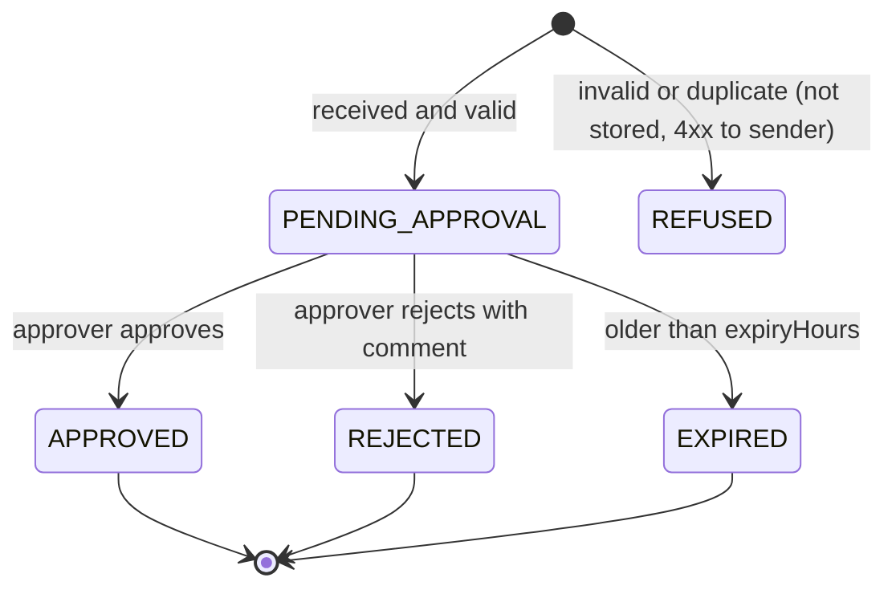
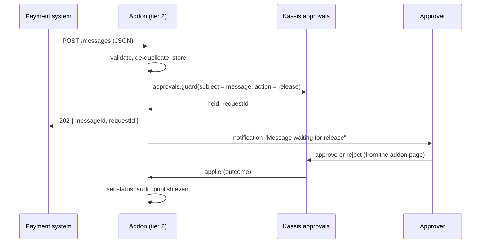

# BRD: SWIFT Message Approval addon

<!-- feature-tracker:start reviewed=2026-11-14 revision=dcf343f2d evidence=source-and-recorded-results runtime-not-rerun -->

| **Feature Name**                    | **Description**                                                           | **Status**     | **Work Involved / Complexity**                                     | **Dependencies**                                                                                                  |
| ----------------------------------- | ------------------------------------------------------------------------- | -------------- | ------------------------------------------------------------------ | ----------------------------------------------------------------------------------------------------------------- |
| Platform prerequisites              | Existing CLI, signing, approvals and tier 2 runtime.                      | 🟢 Completed   | Reusable foundation exists; it is not the SWIFT addon.             | [Source](../../../../packages/addon-cli); [Source](../../../../server/shared/features/approvals)                  |
| FR-01-FR-08: ingestion and storage  | Validate parsed SWIFT messages, dedupe, persist and audit.                | 🔴 Not Started | Medium: implement endpoints, owned data and threshold checks.      | Named external addon project not found; [ADK follow-up](../../remediation/ADK-framework-fixes.md) P3 own-data gap |
| FR-10-FR-18: list and detail        | Filters, pagination, locale amounts, raw-text detail and approval status. | 🔴 Not Started | Medium: create payment page and detail panel.                      | Ingestion contract; host-sdk UI and permissions                                                                   |
| FR-20-FR-26: approval flow          | Maker exclusion, comment rules, two approvers and outcome applier.        | 🔴 Not Started | Medium: register subject/applier and configure approval policies.  | Core approvals; addon permissions; platform prerequisite checks P1-P6                                             |
| FR-30/FR-35-FR-41: jobs and events  | Expire pending messages, notify reviewers and publish outcomes.           | 🔴 Not Started | Small: register timer, scoped notices and audited event contracts. | Approval outcomes; jobs/notification facades                                                                      |
| FR-50-FR-57: settings               | Currency thresholds, message types, expiry and admin configuration.       | 🔴 Not Started | Small: add settings panel and runtime validation.                  | Settings namespace and administrator permissions                                                                  |
| FR-60/FR-61: health and MCP         | Report enforced policy and expose safe pending-message summaries.         | 🔴 Not Started | Small: health check and optional manifest-declared MCP tool.       | Approval policy; MCP contribution contract                                                                        |
| AT-01-AT-20: acceptance and package | Prove security, lifecycle, UI and signing; deliver addon/evidence files.  | 🔴 Not Started | Medium: run Mode A/B matrix and record blocked cases honestly.     | Implemented addon, signed package and running local instance                                                      |

<!-- feature-tracker:end -->

## Detailed specification and dated evidence

| Field                              | Value                                                                                                    |
| ---------------------------------- | -------------------------------------------------------------------------------------------------------- |
| Document                           | BRD-ADK-001                                                                                              |
| Version                            | 0.1 (draft for the first ADK build test)                                                                 |
| Date                               | 2026-10-28                                                                                               |
| Owner                              | Joe Assaf                                                                                                |
| Addon id                           | `acme-swift-approval`                                                                                    |
| Publisher                          | `acme` (client publisher, tier 2 only, id prefix `acme-`)                                                |
| Rung                               | 3, code addon (own data, own page)                                                                       |
| Tier                               | 2                                                                                                        |
| Project folder                     | `C:\Users\Joe Assaf\Documents\GitHub\kassis-addons\acme-swift-approval\` (outside the Kassis repository) |
| Installed location on the instance | `addons-installed/acme-swift-approval/<version>/`, written by the deploy approval, never by hand         |

---

## 0. How the build agent uses this document

You build this addon with the Kassis ADK and nothing else.

1. **ADK only.** Use the installed `@kassis/addon-cli` (`npx kassis-addon ...`), `@kassis/addon-sdk`, `@kassis/host-sdk`, `@kassis/addon-ui` and `@kassis/addon-testkit`, the ADK MCP server, and the ADK guide. Do not open, read, copy or edit any file of the Kassis repository (`KASSIS-PROTOTYPE`).
2. **Work only in the project folder** named above. Create it with `npx kassis-addon init --id=swift-approval --publisher=acme --rung=3 --dir=<project folder>`. The CLI prefixes the id to `acme-swift-approval`.
3. **Pin the guardrails.** Run `npx kassis-addon sync --profile=addon-coding-agent` first and follow `AGENTS.md`. Fill `.kassis/attestation.json` honestly before you certify.
4. **Prerequisites first.** Run section 10 before writing feature code. It decides between build Mode A and build Mode B.
5. **Never work around the platform.** If the ADK cannot do something this document asks for, do not:
   - switch to tier 1;
   - open a direct database connection;
   - write to core tables;
   - store business data in user preferences or settings;
   - import host code.

   Record the gap in `GAPS.md` (section 10.3) and build the rest.

6. **Copy this document** into the project as `REQUIREMENTS.md`. The evidence pack and the deployment approval link to it.
7. **Done means** every Must requirement of your build mode is met, `certify` passes, the package is signed and deployed to the local instance, the acceptance tests in section 11 are recorded in `TEST-REPORT.md`, and `GAPS.md` lists every blocked item.

Requirement priority uses MoSCoW: **M** must, **S** should, **C** could.

---

## 1. Purpose and background

Banks send payments to other banks as SWIFT messages. Most outgoing payments (MT103, customer transfer) and bank transfers (MT202) must be released by an authorised person before they leave the bank. That second pair of eyes is the four-eyes principle: the person or system that created the payment cannot release it alone.

This addon gives Kassis a simple release queue:

1. Kassis receives SWIFT messages from the payment system.
2. Authorised users see them in a dedicated page.
3. An authorised user approves (releases) or rejects each message, with a comment.
4. Every step is audited, and other systems are told about the outcome.

It is deliberately small. Its second purpose is to prove that a client can build, sign, deploy and run a tier 2 addon with the ADK alone.

---

## 2. Scope

### In scope

- Receive SWIFT messages as JSON over an authenticated HTTP route.
- Validate, store and list them.
- Approve or reject them through the Kassis approval engine, with maker-checker.
- Settings managed by a Kassis administrator.
- A page in the Kassis navigation, a detail view and a settings tab.
- Audit, events, notifications and a scheduled expiry job.
- A read-only MCP tool that lists pending messages.

### Out of scope

- Sending messages to the SWIFT network. The addon publishes an event; another system releases the payment.
- Parsing every SWIFT field. Only the fields in section 6.1 are parsed.
- ISO 20022 (pacs.008, pacs.009). This is a later version.
- Sanctions screening and repair of messages. Those are other Kassis capabilities.
- Editing a message. A wrong message is rejected and sent again.

---

## 3. Users, roles and permissions

| Actor               | Who                                 | What they can do                      |
| ------------------- | ----------------------------------- | ------------------------------------- |
| Payment system      | An API key (service principal)      | Submit messages                       |
| Payment operator    | Back-office user                    | View messages                         |
| Payment approver    | Senior back-office or treasury user | View, approve, reject                 |
| Addon administrator | Kassis administrator                | Change the addon settings             |
| Auditor             | Compliance or internal audit        | View messages and history (read only) |

The addon declares these permissions in its own namespace:

| Permission                    | Purpose                                                                        |
| ----------------------------- | ------------------------------------------------------------------------------ |
| `acme-swift-approval.view`    | See the page, the list and the details                                         |
| `acme-swift-approval.ingest`  | Submit messages through the route. Given to the payment system's API key only. |
| `acme-swift-approval.approve` | See the Approve and Reject buttons                                             |
| `acme-swift-approval.admin`   | See and change the settings tab                                                |

Who may actually decide is set by the Kassis approval policy for subject type `acme-swift-approval.message` (section 7). A user needs both `acme-swift-approval.approve` and eligibility in that policy. The approval engine enforces the policy; the addon only hides buttons.

---

## 4. Business process





---

## 5. Functional requirements

### 5.1 Receiving messages

| ID    | Pri | Requirement                                                                                                                                                                                                                                                                                                                                                                                                                                                                                                                          |
| ----- | --- | ------------------------------------------------------------------------------------------------------------------------------------------------------------------------------------------------------------------------------------------------------------------------------------------------------------------------------------------------------------------------------------------------------------------------------------------------------------------------------------------------------------------------------------ |
| FR-01 | M   | The addon mounts `POST /messages`, so the full path is `/api/v1/addons/acme-swift-approval/messages`. Callers need `acme-swift-approval.ingest`.                                                                                                                                                                                                                                                                                                                                                                                     |
| FR-02 | M   | The body is JSON with the fields in section 6.1. `rawText` is the original SWIFT text block.                                                                                                                                                                                                                                                                                                                                                                                                                                         |
| FR-03 | M   | Validation. A failed field returns 422 with the field and the reason, and nothing is stored. The rules:<br>- `messageType` is one of the allowed types in the settings;<br>- `reference` (field 20) is 1 to 16 characters and does not start or end with `/` or contain `//`;<br>- `senderBic` and `receiverBic` match `^[A-Z]{4}[A-Z]{2}[A-Z0-9]{2}([A-Z0-9]{3})?$`;<br>- `currency` is three capital letters;<br>- `amount` is a positive decimal with at most 2 decimals, sent as a string;<br>- `valueDate` is a valid ISO date. |
| FR-04 | M   | A second message with the same `senderBic` and `reference` returns 409 and is not stored. _Mode A only._                                                                                                                                                                                                                                                                                                                                                                                                                             |
| FR-05 | M   | A valid message is stored with status `PENDING_APPROVAL`. An approval request is then opened (FR-20). The answer is 202 with `messageId`, `requestId` and `status`.                                                                                                                                                                                                                                                                                                                                                                  |
| FR-06 | M   | `highValue` is true when `amount` is at or above the threshold for that currency in the settings. It is also true for a currency that has no threshold.                                                                                                                                                                                                                                                                                                                                                                              |
| FR-07 | S   | Messages above `maxAmountPerMessage` in the settings are refused with 422.                                                                                                                                                                                                                                                                                                                                                                                                                                                           |
| FR-08 | M   | Audit actions:<br>- `acme-swift-approval.message.received` on a valid message;<br>- `acme-swift-approval.message.refused` on 409 or 422, with the reason but without `rawText`.                                                                                                                                                                                                                                                                                                                                                      |

### 5.2 Message list page

| ID    | Pri | Requirement                                                                                                                                                 |
| ----- | --- | ----------------------------------------------------------------------------------------------------------------------------------------------------------- |
| FR-10 | M   | A navigation entry "SWIFT approvals" in section "Payments" opens the page. It is visible with `acme-swift-approval.view`.                                   |
| FR-11 | M   | The list shows: received at, message type, reference, sender BIC, receiver BIC, value date, currency, amount, a high value badge, and status. Newest first. |
| FR-12 | M   | Filters: status (default `PENDING_APPROVAL`), message type, currency and value date range. _Mode B: status filter only, see 10.2._                          |
| FR-13 | S   | Paging of 25 rows per page.                                                                                                                                 |
| FR-14 | S   | Amounts use the user's locale, with the currency code beside them.                                                                                          |
| FR-15 | M   | An empty list shows "No messages waiting for release" rather than an empty table.                                                                           |

### 5.3 Message detail

| ID    | Pri | Requirement                                                                                                                                             |
| ----- | --- | ------------------------------------------------------------------------------------------------------------------------------------------------------- |
| FR-16 | M   | Clicking a row opens a detail panel with every parsed field and `rawText` in a monospace block. Line breaks are kept.                                   |
| FR-17 | M   | The panel shows the approval status and history from Kassis approvals (`ApprovalStatusPanel` or `useApprovalStatusForSubject` from `@kassis/host-sdk`). |
| FR-18 | S   | A copy button copies `rawText`.                                                                                                                         |

### 5.4 Approve and reject

| ID    | Pri | Requirement                                                                                                                                                                                                                                                                                      |
| ----- | --- | ------------------------------------------------------------------------------------------------------------------------------------------------------------------------------------------------------------------------------------------------------------------------------------------------ |
| FR-20 | M   | Each stored message opens one approval request through `ctx.core.approvals.guard`. The request has:<br>- `subjectType`: `acme-swift-approval.message`;<br>- `subjectId`: the message id;<br>- `action`: `release`;<br>- `proposedChange`: the parsed fields without `rawText`, plus `highValue`. |
| FR-21 | M   | Users with `acme-swift-approval.approve` see Approve and Reject buttons on a `PENDING_APPROVAL` message. The buttons call the approval decision through `useApprovalInbox().decide(requestId, 'approve' \| 'reject', comment)` from `@kassis/host-sdk`.                                          |
| FR-22 | M   | Reject needs a comment of at least 10 characters. Approve needs one only when `requireApproveComment` is true in the settings.                                                                                                                                                                   |
| FR-23 | M   | Maker-checker: the principal that submitted the message cannot decide it. The policy has `makerExcluded`. The UI also hides the buttons for the maker.                                                                                                                                           |
| FR-24 | M   | The addon registers an applier for `acme-swift-approval.message` with `ctx.core.approvals.registerApplier`. On approval it sets `APPROVED`; on rejection, `REJECTED` with the comment. It also records `decided_by` and `decided_at`, writes the audit action and publishes the event (FR-40).   |
| FR-25 | S   | High value messages need two different approvers. This is done in the approval policy (section 7), not in addon code. If the policy cannot express it, record it in `GAPS.md`.                                                                                                                   |
| FR-26 | M   | A decided message cannot be decided again. The buttons disappear and the approval engine refuses a second decision.                                                                                                                                                                              |

### 5.5 Expiry

| ID    | Pri | Requirement                                                                                                                                                                                                                  |
| ----- | --- | ---------------------------------------------------------------------------------------------------------------------------------------------------------------------------------------------------------------------------- |
| FR-30 | S   | A job `acme-swift-approval.expire` runs every 15 minutes (`ctx.jobs.schedule`). It sets `EXPIRED` on messages still `PENDING_APPROVAL` after `expiryHours`, and writes `acme-swift-approval.message.expired`. _Mode A only._ |

### 5.6 Notifications

| ID    | Pri | Requirement                                                                                                                                                                                                                   |
| ----- | --- | ----------------------------------------------------------------------------------------------------------------------------------------------------------------------------------------------------------------------------- |
| FR-35 | S   | A new message sends a notification "SWIFT message waiting for release: \<reference\> \<amount\> \<currency\>" through `ctx.notify.send` to users with `acme-swift-approval.approve`. A high value message uses priority high. |
| FR-36 | C   | A rejected message notifies the operators who viewed it.                                                                                                                                                                      |

### 5.7 Settings

The settings are declared as `config.schema` in the manifest. Kassis validates them before `initialize()`. Administrators edit them in the addon's settings tab, which reads and writes through the host addon configuration API (`GET` and `PUT /api/v1/addons/acme-swift-approval/configuration`).

| ID    | Pri | Setting                 | Type                             | Default                                             |
| ----- | --- | ----------------------- | -------------------------------- | --------------------------------------------------- |
| FR-50 | M   | `allowedMessageTypes`   | array of `MT103`, `MT202`        | `["MT103","MT202"]`                                 |
| FR-51 | M   | `highValueThresholds`   | map of currency to amount string | `{"CHF":"1000000","EUR":"1000000","USD":"1000000"}` |
| FR-52 | S   | `maxAmountPerMessage`   | amount string or null            | `null`                                              |
| FR-53 | S   | `expiryHours`           | integer, 1 to 168                | `24`                                                |
| FR-54 | M   | `requireApproveComment` | boolean                          | `false`                                             |
| FR-55 | S   | `notifyApprovers`       | boolean                          | `true`                                              |

| ID    | Pri | Requirement                                                                                                                                                |
| ----- | --- | ---------------------------------------------------------------------------------------------------------------------------------------------------------- |
| FR-56 | M   | The settings tab is registered with `settingsTabSlot('acme-swift-approval')` from `@kassis/host-sdk`. It is visible only with `acme-swift-approval.admin`. |
| FR-57 | M   | A settings change takes effect for the next message, with no redeploy.                                                                                     |

### 5.8 Audit and events

| ID    | Pri | Requirement                                                                                                                                                                                                                                                                                                                            |
| ----- | --- | -------------------------------------------------------------------------------------------------------------------------------------------------------------------------------------------------------------------------------------------------------------------------------------------------------------------------------------- |
| FR-40 | M   | The addon publishes `acme-swift-approval.message.approved` and `acme-swift-approval.message.rejected`, each with a JSON schema file declared in `events.publishes`. The payload is `messageId`, `reference`, `senderBic`, `receiverBic`, `currency`, `amount`, `valueDate`, `decidedBy`, `decidedAt` and `comment`, without `rawText`. |
| FR-41 | M   | Every audit action is declared in `audit.actions`:<br>- `acme-swift-approval.message.received`;<br>- `acme-swift-approval.message.refused`;<br>- `acme-swift-approval.message.approved`;<br>- `acme-swift-approval.message.rejected`;<br>- `acme-swift-approval.message.expired`.                                                      |

### 5.9 Health and MCP

| ID    | Pri | Requirement                                                                                                                                                                                                              |
| ----- | --- | ------------------------------------------------------------------------------------------------------------------------------------------------------------------------------------------------------------------------ |
| FR-60 | M   | A health route (`health.path`) returns 200 when the addon is initialised and the approval policy is enforced (`ctx.core.approvals.isEnforced('acme-swift-approval.message')`). It returns 503 with the reason otherwise. |
| FR-61 | C   | An MCP tool `acme-swift-approval.list_pending` returns up to 25 pending messages (id, reference, amount, currency, highValue), without `rawText`. It is read only and gated by `acme-swift-approval.view`.               |

---

## 6. Data requirements

### 6.1 Message fields

| Field              | SWIFT tag                      | Type               | Required  |
| ------------------ | ------------------------------ | ------------------ | --------- |
| `messageType`      | block 2                        | `MT103` or `MT202` | yes       |
| `reference`        | :20:                           | text, max 16       | yes       |
| `senderBic`        | block 1                        | BIC 8 or 11        | yes       |
| `receiverBic`      | block 2                        | BIC 8 or 11        | yes       |
| `valueDate`        | :32A: date                     | ISO date           | yes       |
| `currency`         | :32A: currency                 | ISO 4217 code      | yes       |
| `amount`           | :32A: amount                   | decimal string     | yes       |
| `orderingCustomer` | :50K: (MT103) or :52A: (MT202) | text, max 140      | MT103 yes |
| `beneficiary`      | :59: (MT103) or :58A: (MT202)  | text, max 140      | yes       |
| `remittanceInfo`   | :70:                           | text, max 140      | no        |
| `rawText`          | whole message                  | text, max 10,000   | yes       |

The addon trusts the JSON fields and does not re-parse `rawText`. Re-parsing `rawText` and comparing it with the fields is a Could (FR-09).

### 6.2 Own tables (Mode A)

Schema `addon_acme_swift_approval`, declared in `data.schema`. Each table is listed in `database.ownedTables`. Migration `0001_init.up.sql` creates them and `0001_init.down.sql` drops them.

**`swift_messages`**

| Column                | Type              | Notes                                                   |
| --------------------- | ----------------- | ------------------------------------------------------- |
| `id`                  | uuid, primary key | Generated by the addon                                  |
| `message_type`        | text              | `MT103` or `MT202`                                      |
| `reference`           | text              |                                                         |
| `sender_bic`          | text              |                                                         |
| `receiver_bic`        | text              |                                                         |
| `value_date`          | date              |                                                         |
| `currency`            | char(3)           |                                                         |
| `amount`              | numeric(18,2)     |                                                         |
| `ordering_customer`   | text              |                                                         |
| `beneficiary`         | text              |                                                         |
| `remittance_info`     | text, null        |                                                         |
| `raw_text`            | text              | Sensitive; never logged                                 |
| `high_value`          | boolean           |                                                         |
| `status`              | text              | `PENDING_APPROVAL`, `APPROVED`, `REJECTED` or `EXPIRED` |
| `approval_request_id` | text              | From FR-20                                              |
| `received_at`         | timestamptz       |                                                         |
| `decided_by`          | text, null        |                                                         |
| `decided_at`          | timestamptz, null |                                                         |
| `decision_comment`    | text, null        |                                                         |

Unique `(sender_bic, reference)`, plus indexes on `status` and `received_at`.

**`swift_message_history`**: `id`, `message_id`, `from_status`, `to_status`, `actor`, `at`, `comment`. One row per status change.

### 6.3 What is reused from Kassis core, not built

| Need                                                                        | Core capability       | Through                                                                                                                      |
| --------------------------------------------------------------------------- | --------------------- | ---------------------------------------------------------------------------------------------------------------------------- |
| Four-eyes decision, approver eligibility, maker exclusion, decision history | Approval engine       | `ctx.core.approvals.guard`, `registerApplier`, `isEnforced`; `useApprovalInbox`, `ApprovalStatusPanel` in `@kassis/host-sdk` |
| Who did what                                                                | Audit log             | `ctx.audit.record`, `audit.actions`                                                                                          |
| Telling other systems                                                       | Event bus             | `ctx.events.publish`, `events.publishes`                                                                                     |
| Telling approvers                                                           | Notifications         | `ctx.notify.send`                                                                                                            |
| Expiry                                                                      | Job scheduler         | `ctx.jobs.schedule`, `jobs.types`                                                                                            |
| Settings                                                                    | Addon configuration   | `config.schema`, host configuration API, `settingsTabSlot`                                                                   |
| Access                                                                      | Permissions and roles | `permissions` in the manifest                                                                                                |
| Page and navigation                                                         | Runtime UI            | `ui.contributions.nav`, `routes`, `register()`                                                                               |

Flags are not used in this version. `highValue` is a column, because core flags attach to core records and a SWIFT message is not one.

---

## 7. Approval policy (set up in Kassis, not in the addon)

The addon cannot create approval policies. Before the acceptance tests, a Kassis administrator publishes this policy in the approvals settings:

- Subject type `acme-swift-approval.message`, action `release`.
- One step: one approver with role `payment_approver` (or an existing role chosen for the test), `makerExcluded: true`.
- If conditions on `proposedChange.highValue` are supported: a second step for high value messages, two approvers, `earlierApproversExcluded: true` (FR-25).

The build agent writes these steps in `README.md` under "Operator setup" and checks them through FR-60. It does not create the policy itself.

---

## 8. Non-functional requirements

| ID     | Pri | Requirement                                                                                                                                     |
| ------ | --- | ----------------------------------------------------------------------------------------------------------------------------------------------- |
| NFR-01 | M   | Tier 2. `resources.memoryMb` is 256. No `egress.hosts`: the addon calls no outside system.                                                      |
| NFR-02 | M   | `raw_text`, `ordering_customer`, `beneficiary` and `remittance_info` never appear in logs, audit details, events or notifications.              |
| NFR-03 | M   | Every route and the page check permissions. The ingest route accepts only `acme-swift-approval.ingest`.                                         |
| NFR-04 | S   | Accepting a message takes under 500 ms (p95) on the local stack. The list loads 25 rows in under 2 s with 5,000 stored messages.                |
| NFR-05 | M   | All user-visible text goes through the addon i18n helpers, in English and French. Do not import `i18next`.                                      |
| NFR-06 | S   | The page is usable with the keyboard alone, and badges carry text, not colour only.                                                             |
| NFR-07 | M   | `npx kassis-addon conformance` reports no host imports. Only `@kassis/*` and declared dependencies are used.                                    |
| NFR-08 | M   | Unit tests with `createTestContext()` cover validation, de-duplication, high value logic, the applier (approve and reject) and the expiry rule. |

---

## 9. Build constraints

- **Manifest outline**, which the agent completes:
  - `id`, `publisher: "acme"`, `tier: 2`, `hostApi: "^1.0.0"`;
  - `entrypoints.main: "dist/server/index.js"`;
  - `data.schema`, `database.ownedTables`, `permissions`;
  - `config.schema`, `audit.actions`, `events.publishes`, `jobs.types`, `health.path`;
  - `resources.memoryMb`;
  - `ui` with `entryFile: "index.js"`, `runtimeLoad: true` and `contributions.nav`;
  - `contributions.mcp` (if FR-61).
- **Commands, in order:**

  | Step                                        | Command                                              |
  | ------------------------------------------- | ---------------------------------------------------- |
  | Pin guardrails                              | `sync`                                               |
  | Develop                                     | `build`, `test`, `check`, `conformance`              |
  | Preview, if the dev host image is available | `dev`                                                |
  | Attest and certify                          | `attest`, then fill the answers, then `certify`      |
  | Package                                     | `sbom`, then `sign --key=<acme key>`, then `package` |
  | Deploy                                      | `deploy --instance=<local instance>`                 |
  | Check                                       | `status --instance=<local instance>`                 |

- Signing uses the `acme` key registered and approved on the local instance. Never use the Kassis key.
- Version `0.1.0`. The changelog entry names this BRD.

---

## 10. Platform prerequisites and known gaps

### 10.1 Check before building

Run these checks first and record the results in `TEST-REPORT.md`.

| Check                                     | How                                                                                                    | Known state on 2026-10-28                                                                                                                |
| ----------------------------------------- | ------------------------------------------------------------------------------------------------------ | ---------------------------------------------------------------------------------------------------------------------------------------- |
| P1. Tier 2 can write its own tables       | ADK docs, the `addon-sdk` `ctx.data` types, or a scaffolded test that inserts a row through `ctx.data` | **Not available.** Tier 2 offers only `ctx.data.read`: one table, all rows up to 100, no filter, no ordering. Writes are refused.        |
| P2. Addon migrations run on install       | Deploy a build whose migration creates a table, then read it with `ctx.data.read`                      | **Not available.** The migration runner exists in Kassis but is not called on install. `kassis-addon migrate` only targets the dev host. |
| P3. The approval policy is enforced       | FR-60 health route after operator setup                                                                | Depends on section 7                                                                                                                     |
| P4. Policy conditions on `proposedChange` | Approvals settings                                                                                     | Unknown                                                                                                                                  |
| P5. The installed addon UI loads          | Open the page after deploy                                                                             | Fixed in code on `fix/adk-round-2`, not yet proven live                                                                                  |
| P6. First-party addons still load         | Kassis home page and one first-party page after deploy                                                 | Open: round-2 regression on `uiContentHash`                                                                                              |

### 10.2 Build modes

- **Mode A (target).** P1 and P2 are available. Build everything in this document.
- **Mode B (today).** P1 or P2 is missing. Build the same addon without own tables:
  - the approval request is the record: `proposedChange` holds the parsed fields and `highValue`;
  - the list page shows the approver's open and decided requests for subject type `acme-swift-approval.message`, from `useApprovalInbox()`. Its status filter is the only filter;
  - the detail panel reads `proposed_change` from the request. `rawText` is not stored, because it must not go into an approval request (NFR-02). The panel says "Raw message not stored in this version";
  - the applier writes audit and publishes the events (FR-24 without the table update);
  - FR-04, FR-12 (except status), FR-30 and the `swift_*` tables are not built. Each goes in `GAPS.md`;
  - `data`, `database` and `migrations/` stay in the project so the code is ready for Mode A, but the manifest does not declare the tables. Say so in `README.md`.

### 10.3 `GAPS.md`

One entry per blocked requirement:

```markdown
## GAP-01 Tier 2 cannot write owned tables

Requirement: FR-04, FR-05 (store), FR-24 (status update), FR-30
Check: <command or test that proved it>
Observed: <exact error text or KADK code>
Mode B behaviour: <what the addon does instead>
Needed from the platform: <the smallest capability that would unblock it>
```

A gap is a finding about the ADK, not a failure of the build.

---

## 11. Acceptance tests

Run them on the local instance after deploy and approval of the package. Record each result in `TEST-REPORT.md` with the request and the response or a screenshot.

### 11.1 Sample messages

**S1. Normal MT103**

```json
{
  "messageType": "MT103",
  "reference": "ACME20261028001",
  "senderBic": "ACMECHZZXXX",
  "receiverBic": "BETADEZZXXX",
  "valueDate": "2026-10-30",
  "currency": "CHF",
  "amount": "12500.00",
  "orderingCustomer": "Lab Customer AG, Bahnhofstrasse 1, 8001 Zurich",
  "beneficiary": "Lab Supplier GmbH, Hauptstrasse 5, 10115 Berlin",
  "remittanceInfo": "Invoice 4711",
  "rawText": "{1:F01ACMECHZZAXXX0000000000}{2:I103BETADEZZXXXXN}{4:\n:20:ACME20261028001\n:23B:CRED\n:32A:261030CHF12500,00\n:50K:/CH9300762011623852957\nLab Customer AG\n:59:/DE89370400440532013000\nLab Supplier GmbH\n:70:Invoice 4711\n:71A:SHA\n-}"
}
```

- **S2. High value MT202:** as S1 but `messageType` `MT202`, `reference` `ACME20261028002`, `currency` `EUR`, `amount` `2500000.00`, `orderingCustomer` omitted, `beneficiary` `"GAMMGB2LXXX"`.
- **S3. Invalid BIC:** as S1 but `reference` `ACME20261028003`, `receiverBic` `"BETA-DE"`.
- **S4. Duplicate:** S1 sent a second time.
- **S5. Unknown currency:** as S1 but `reference` `ACME20261028005`, `currency` `XAU`, `amount` `10.00`.

All BICs and accounts are fictitious test values.

### 11.2 Tests

| ID    | Covers              | Steps                                                                                                       | Expected                                                                                 |
| ----- | ------------------- | ----------------------------------------------------------------------------------------------------------- | ---------------------------------------------------------------------------------------- |
| AT-01 | FR-01, NFR-03       | POST S1 with a user token that lacks `ingest`                                                               | 403                                                                                      |
| AT-02 | FR-05, FR-08, FR-35 | POST S1 with the payment system API key                                                                     | 202 with `messageId` and `requestId`; audit `received`; approvers notified               |
| AT-03 | FR-03               | POST S3                                                                                                     | 422 naming `receiverBic`; nothing stored; audit `refused`                                |
| AT-04 | FR-04               | POST S4                                                                                                     | Mode A: 409. Mode B: gap recorded                                                        |
| AT-05 | FR-06               | POST S2 and S5                                                                                              | Both `highValue: true`                                                                   |
| AT-06 | FR-10, FR-11, FR-15 | Operator opens the page                                                                                     | Nav entry visible; S1, S2 and S5 listed and pending; no Approve buttons for the operator |
| AT-07 | FR-16, FR-17        | Open S1                                                                                                     | All fields; raw text (Mode A); approval status panel                                     |
| AT-08 | FR-23               | The maker identity tries to approve S1                                                                      | Buttons hidden; a direct decision is refused by approvals                                |
| AT-09 | FR-21, FR-24, FR-40 | Approver approves S1                                                                                        | Status `APPROVED`; history row (Mode A); audit `approved`; event published               |
| AT-10 | FR-22               | Approver rejects S2 with a 3-character comment, then with a proper comment                                  | First refused; second gives `REJECTED` with the comment; event published                 |
| AT-11 | FR-26               | Try to approve S1 again                                                                                     | Refused; no status change                                                                |
| AT-12 | FR-25               | S2 approved by one approver (only if P4 is available)                                                       | Still pending until a second approver decides                                            |
| AT-13 | FR-30               | Set `expiryHours` to 1, post a message, run the job after the hour (or with a test clock in the unit tests) | `EXPIRED` (Mode A)                                                                       |
| AT-14 | FR-50, FR-57        | Remove `MT202` from `allowedMessageTypes` in the settings tab, then POST S2 with a new reference            | 422 without a redeploy                                                                   |
| AT-15 | FR-56               | Operator opens Settings                                                                                     | No addon tab; an administrator sees it                                                   |
| AT-16 | FR-60               | Health route before and after the policy is published                                                       | 503 with the reason, then 200                                                            |
| AT-17 | FR-61               | Call the MCP tool                                                                                           | Pending messages without `rawText`                                                       |
| AT-18 | NFR-02              | Search the backend logs, the audit details and the event payloads for `Lab Customer AG`                     | Not found                                                                                |
| AT-19 | Platform            | Restart the backend container                                                                               | Addon reloads from `addons-installed`; data and settings kept                            |
| AT-20 | Platform, P6        | Open a first-party addon page (for example Control Room)                                                    | Loads normally                                                                           |

---

## 12. Deliverables

In the project folder:

- [ ] Source: `src/server/`, `src/ui/`, `migrations/` (Mode A), `test/`, event schemas
- [ ] `manifest.json`, signed with the `acme` key
- [ ] `REQUIREMENTS.md` (this document), `README.md` with an "Operator setup" section, `CHANGELOG.md`
- [ ] `.kassis/` lock, attestation and evidence; a passing `certify`
- [ ] `acme-swift-approval-0.1.0.addon` and its sha256
- [ ] `TEST-REPORT.md` with P1 to P6 and AT-01 to AT-20 (pass, fail, blocked, each with evidence)
- [ ] `GAPS.md`

---

## 13. Assumptions and open questions

| #   | Item                                                                        | Default for this build                                  |
| --- | --------------------------------------------------------------------------- | ------------------------------------------------------- |
| A1  | Messages arrive already parsed as JSON from the payment system              | Yes, `rawText` is kept for display only                 |
| A2  | One approval per message; batch approval is not needed                      | Single only                                             |
| A3  | Amounts are compared per currency, without exchange rates                   | Yes                                                     |
| Q1  | Should rejected messages be resubmittable under the same reference?         | No: a new reference is needed                           |
| Q2  | Should approvers see messages from all senders or only their business unit? | All senders in version 0.1                              |
| Q3  | Is a release to the payment system (outbound call) needed in version 0.2?   | Open; it would add an `egress.hosts` entry and a secret |
