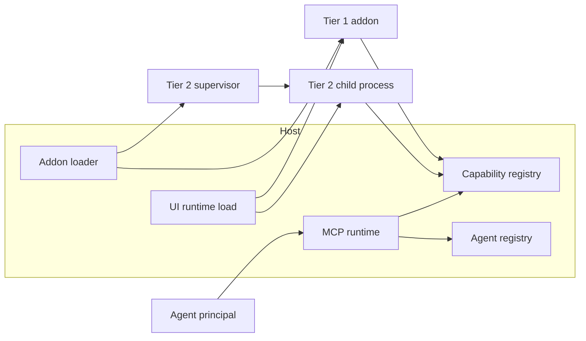

# Addon Development Kit

**Status:** GA
**Version checked:** 2026-10-28
**Technical owner:** Unassigned
**Last reviewed:** 2026-10-28

The Addon Development Kit (ADK) is how a Kassis addon is created, checked, signed, and loaded. It is also how an AI coding agent is given a signed profile, and how an operator turns an addon on.

## Who it is for

- **Addon developers** build a tier 1 or tier 2 addon and ship it with `kassis-addon`.
- **AI coding agents** follow the signed `addon-coding-agent` profile. `sync` writes the lock file and the rule files the agent must attest to.
- **Operators** enable addons, apply release seeds, and install an air-gapped bundle.

## Architecture

Tier 1 addons run in the host process. Tier 2 addons run in a child process and do not need their own entry file. The host forwards their HTTP routes and MCP tools. In-repo addon pages load from the host bundle through `/runtime-addons.json`. An addon built outside the repository leaves `@kassis/host-sdk` and `@kassis/addon-ui` external, and the host serves those modules from `/host-sdk/`. Agent principals call MCP tools through the agent registry, which can turn a final decision into an approval request. Approving that request does not run the tool.

## Reading order

1. [Install](./install.md)
2. [Quickstart](./quickstart.md)
3. [Addon anatomy](./addon-anatomy.md)
4. [Tiers](./tiers.md)
5. [CLI reference](./cli-reference.md)
6. [Testing](./testing.md)
7. [Signing and trust](./signing-and-trust.md)
8. [Publishing](./publishing.md)
9. [AI agents](./ai-agents.md)
10. [Operators](./operators.md)

Related pages that this guide does not copy:

- [Addon context facades](../addons/addon-context-facades.md)
- [Semver policy](../addons/semver-policy.md)
- [Frontend i18n](../addons/frontend-i18n.md)
- [Permission namespaces](../addons/permission-namespaces.md)
- [KADK error codes](../reference/adk-error-codes.md)
- [Addon deploy CLI](../addons/addon-deploy-cli.md)
